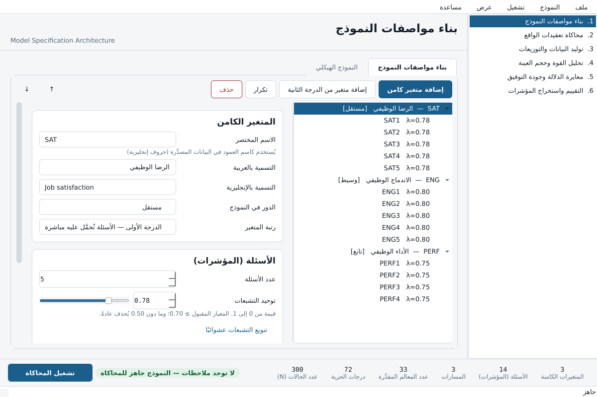

<div align="right">

# محرك محاكاة بيانات النمذجة بالمعادلات البنائية

**مختبر افتراضي لتوليد بيانات تحاكي استجابات البشر الحقيقية**

</div>

# SEM Data Simulation Engine

*[العربية](#نظرة-عامة) · [English](#overview)*

A desktop application for generating structural-equation-model data that
behaves like real survey responses — skewed, categorical, contaminated, and
imperfectly fitting — so a researcher can test a model before collecting
anything.



---

<div dir="rtl" align="right">

## نظرة عامة

في العلوم الإنسانية والاجتماعية والسلوكية نادرًا ما تكون البيانات مثالية؛ فهي
تتّسم بالتعقيد والتداخل والانحراف عن التوزيعات الطبيعية. يتيح هذا البرنامج
للباحثين بناء **مختبر افتراضي** لتوليد بيانات تحاكي استجابات البشر الحقيقية في
الاستبيانات، ممّا يسمح باختبار دقّة النماذج النظرية، وتقييم كفاءة الخوارزميات
الإحصائية، وإثبات فرضيات محددة بقوة إحصائية محكمة — قبل جمع البيانات الفعلية
أو لأغراض دراسات المحاكاة المتقدمة (Monte Carlo Simulations).

### المراحل الست

| # | المرحلة | ما تفعله |
|---|---------|----------|
| ١ | **بناء مواصفات النموذج** | المتغيرات الكامنة وأبعادها وأسئلتها، والنماذج الهرمية من الدرجة الثانية، وتصنيف الأدوار (مستقل، تابع، وسيط، معدِّل) وشبكة المسارات |
| ٢ | **محاكاة تعقيدات الواقع** | التحميلات المتقاطعة، والتغاير بين أخطاء القياس، وعامل طريقة القياس المشترك |
| ٣ | **توليد البيانات والتوزيعات** | نماذج العتبات لمقاييس ليكرت، والتحكم الكامل في الالتواء والتفلطح، وحقن التشويش العشوائي |
| ٤ | **تحليل القوة وحجم العينة** | اقتراح حجم العينة الأمثل استنادًا إلى درجات حرية النموذج |
| ٥ | **معايرة الدلالة وجودة التوفيق** | استهداف كل مسار ليكون دالًا أو غير دال، وضبط مؤشرات التوفيق على المستوى المطلوب |
| ٦ | **التقييم واستخراج المؤشرات** | ألفا كرونباخ والثبات المركب و AVE والصدق التمايزي و RMSEA و CFI و TLI و SRMR |

### ما يميّز هذا البرنامج

- **نماذج العتبات لا التقريب البسيط.** تحويل المتغير الكامن المتصل إلى استجابة
  فئوية يتم عبر عتبات محسوبة من نِسب الفئات المستهدفة، لا بتقريب رقم عشري —
  لأن التقريب يشوّه التوزيع ويُفسد الارتباطات.
- **الالتواء والتفلطح بطريقة Vale-Maurelli.** تتحقق القيم المطلوبة على مستوى كل
  سؤال مع الحفاظ على مصفوفة الارتباط المستهدفة في الوقت نفسه.
- **هندسة عكسية حقيقية لجودة التوفيق.** يستخدم البرنامج طريقة
  Cudeck & Browne (1992) التي تَحقن خطأ نموذج بمقدار محسوب **مع إبقاء معالم
  النموذج التي حددتها هي نقطة النهاية الصغرى بالضبط** — وليس مجرد إضافة ضوضاء.
- **حلقة معايرة مغلقة.** بعد التوليد يُقدَّر النموذج فعليًا، وتُقارَن مؤشرات
  التوفيق المتحققة بالمستهدفة، ويُعاد الضبط. وسجل المعايرة معروض كاملًا، فالتعديل
  مرئي لا مخفي.
- **تفاعل كامن حقيقي.** حاصل ضرب متغيرين كامنين لا يمكن تمثيله في مصفوفة تغاير،
  لذا يتحول البرنامج تلقائيًا إلى توليد درجات المتغيرات الكامنة عند وجود تعديل.
- **واقعية الاستجابة البشرية.** مستجيبون غير مبالين (خط مستقيم أو إجابات
  عشوائية)، وقيم شاذة مقيَّدة بمدى المقياس، وفقد عشوائي مشروط (MAR).
- **مجتمع واقعي لا نموذج مثالي.** لا تتساوى في البيانات الحقيقية متوسطات
  الأسئلة ولا انحرافاتها ولا تشبعاتها، ولا تأتي المسارات أرقامًا مدوّرة. لذا
  يسحب البرنامج مجتمعًا حول نموذجك: لكل متغير مستوى خاص على المقياس، ولكل سؤال
  صعوبة وتشتت خاصان (كما في نموذج الاستجابة المتدرجة لـ Samejima)، وتتفاوت
  التشبعات والمسارات قليلًا حول القيم المخططة دون أن تتغير إشارتها أو دلالتها
  المطلوبة. والأسئلة معكوسة الصياغة تُجاب بعكس توزيع متغيرها وبتشبع أضعف قليلًا،
  وتظهر بعض الإجابات عند طرفي المقياس في كل سؤال. وتُسحب الفئات الديموغرافية
  عشوائيًا بالنسب المطلوبة افتراضيًا، فتتفاوت أعدادها كما في عينة حقيقية.
- **فروق حقيقية بين الفئات.** لمتغير المقارنة تحدد على أي متغير كامن تختلف
  فئاته، وبأي حجم (d لكوهين أو مربع إيتا)، وأي فئة أعلى، وهل الفرق دال. يُوزَّع
  المستجيبون على الفئات حسب إجاباتهم مع الاحتفاظ بعدد كل فئة، فتظهر الفروق في
  اختبار t وتحليل التباين دون أن تتغير الإجابات أو نتائج النموذج.

### التشغيل

</div>

```bash
pip install -r requirements.txt
python -m semsim
```

```bash
python -m semsim --lang en --theme dark --example messy_reality
```

<div dir="rtl" align="right">

### بناء ملف تنفيذي لويندوز

</div>

```bat
packaging\build_windows.bat
```

<div dir="rtl" align="right">

ينتج `dist\SEMSimulator.exe` — ملف واحد مستقل لا يحتاج تثبيت Python على جهاز
المستخدم. السكربت يبني بيئة نظيفة ويشغّل مجموعة الاختبارات قبل البناء، ويختبر
الملف الناتج بعده.

</div>

---

## Overview

In the human, social and behavioural sciences, data is rarely clean. It is
complex, overlapping, and departs from normality in ways that matter. This
application lets a researcher build a **virtual laboratory**: generate data
that behaves the way real questionnaire responses behave, so a theoretical
model can be tested, an estimator's performance assessed, and a hypothesis
powered properly — before a single respondent is recruited, or as the basis of
a Monte Carlo study.

### The six stages

| # | Stage | What it does |
|---|-------|--------------|
| 1 | **Model specification** | Latent variables, their dimensions and items; second-order constructs; roles (independent, dependent, mediator, moderator) and the path network |
| 2 | **Complex realities** | Cross-loadings, correlated measurement errors, a common method factor |
| 3 | **Distributions and generation** | Threshold models for Likert scales, full control of skewness and kurtosis, noise injection |
| 4 | **Power and sample size** | Recommend N from the model's degrees of freedom |
| 5 | **Significance and fit targeting** | Aim each path at significance or at null; land the fit indices on a chosen level |
| 6 | **Validation and output** | Cronbach's alpha, CR, AVE, discriminant validity, RMSEA, CFI, TLI, SRMR |

### What makes it different

- **Threshold models, not rounding.** Turning a continuous latent response into
  a category uses cut points derived from the intended category proportions.
  Rounding a decimal distorts the distribution and attenuates the correlations.
- **Vale & Maurelli (1983) non-normality.** Each item lands on its requested
  skewness and kurtosis while the whole matrix lands on its target
  correlations.
- **Genuine reverse engineering of fit.** Model error is injected by the method
  of Cudeck & Browne (1992), which perturbs the covariance matrix by a computed
  amount **while keeping your specified parameters as the exact minimiser**.
  That is not the same as adding noise, and the difference shows up the moment
  anyone refits the model.
- **A closed calibration loop.** After generating, the model is actually
  estimated, the realised fit indices are compared against the targets, and the
  injected discrepancy is rescaled. The calibration log is shown in full, so
  the adjustment is auditable rather than hidden.
- **Real latent interactions.** The product of two latent variables has no
  expression in a covariance matrix, so the engine switches to simulating the
  latent scores themselves when the model contains a moderation.
- **Human response realism.** Careless respondents (straight-lining or random
  clicking), outliers clipped to the legal response range, and MAR missingness
  driven by an observed score.
- **A realistic population, not a textbook one.** In real data no two items
  share a mean, a spread or a loading, and no path is a round number. The
  engine draws one population around your model: each construct gets its own
  level on the scale, each item its own difficulty and spread (as in
  Samejima's graded response model), and loadings and paths scatter a little
  around the planned values without changing sign or the requested
  significance. Reverse-worded items are answered as the mirror image of their
  construct and load a little more weakly, and every item gets a few answers
  at both ends of the scale. Demographic categories are drawn at random with
  the requested shares by default, so their counts vary the way a real
  sample's do.
- **Real group differences.** For a comparison variable you set which
  constructs its groups differ on, by how much (Cohen's d or eta squared),
  which group scores highest and whether the difference is significant.
  Respondents are placed in groups by their answers, each group keeping its
  size, so the t-test and ANOVA show the differences while the answers and
  the model results stay exactly as they were.

### Running it

```bash
pip install -r requirements.txt
python -m semsim                       # Arabic interface, light theme
python -m semsim --lang en --theme dark --example messy_reality
python -m semsim --list-examples
```

### Building a Windows executable

```bat
packaging\build_windows.bat
```

Produces a standalone `dist\SEMSimulator.exe` that needs no Python on the
target machine. The script builds in a clean virtual environment, runs the
test suite before building, and smoke-tests the result afterwards.

---

## Architecture

```
semsim/core/        model specification, compilation to LISREL matrices, validation
semsim/generation/  Fleishman, Vale-Maurelli, threshold models, noise, the engine
semsim/analysis/    ML/ULS/DWLS estimation, fit indices, reliability, polychoric
semsim/power/       MacCallum close-fit power, Satorra-Saris, Monte Carlo
semsim/targeting/   Cudeck-Browne model error, significance plans, calibration
semsim/io/          project files, CSV/XLSX/SPSS export, lavaan and Mplus syntax, HTML report
semsim/ui/          PySide6 interface: six stage pages, path diagram, bilingual
```

`docs/ARCHITECTURE.md` carries the published signature and the exact algebra of
every module. Only `semsim.ui` imports PySide6; everything else is headless and
testable.

### Design rules the code actually follows

- Every stochastic function takes an explicit `numpy.random.Generator`. There
  is no global `np.random` call anywhere. The same seed always reproduces the
  same dataset, which is a product feature, not an implementation detail.
- Loadings and path coefficients are **completely standardised** values. The
  compiler derives the implied residual variances so every latent and every
  item has unit total variance, which is what makes "set this path to 0.30"
  mean what a researcher expects.
- Errors a user caused raise `SemSimError` with both an English and a genuinely
  idiomatic Arabic message. A singular matrix never reaches the interface as a
  raw traceback.
- Numbers, identifiers, matrices and model syntax stay left-to-right even in
  the Arabic interface. A correlation matrix read right-to-left is a different
  matrix.

## Interoperability

Every simulated dataset can be exported as CSV, XLSX or SPSS `.sav` with
variable and value labels, alongside ready-to-run **lavaan** syntax for R and
**Mplus** syntax, both generated from the same specification — so the model you
simulated is the model you re-estimate.

## References

- Browne, M. W., & Cudeck, R. (1993). Alternative ways of assessing model fit.
- Cohen, J. (1988). *Statistical Power Analysis for the Behavioral
  Sciences* (2nd ed.). Erlbaum.
- Cudeck, R., & Browne, M. W. (1992). Constructing a covariance matrix that
  yields a specified minimizer and a specified minimum discrepancy function
  value. *Psychometrika, 57*, 357–369.
- Fleishman, A. I. (1978). A method for simulating non-normal distributions.
  *Psychometrika, 43*, 521–532.
- Embretson, S. E., & Reise, S. P. (2000). *Item Response Theory for
  Psychologists*. Erlbaum.
- Hu, L., & Bentler, P. M. (1999). Cutoff criteria for fit indexes in
  covariance structure analysis. *Structural Equation Modeling, 6*, 1–55.
- MacCallum, R. C., & Tucker, L. R. (1991). Representing sources of error in
  the common-factor model. *Psychological Bulletin, 109*, 502–511.
- MacCallum, R. C., Browne, M. W., & Sugawara, H. M. (1996). Power analysis and
  determination of sample size for covariance structure modeling.
  *Psychological Methods, 1*, 130–149.
- Muthén, L. K., & Muthén, B. O. (2002). How to use a Monte Carlo study to
  decide on sample size and determine power.
- Samejima, F. (1969). Estimation of latent ability using a response pattern
  of graded scores. *Psychometrika Monograph Supplement, 34*(4, Pt. 2).
- Satorra, A., & Saris, W. E. (1985). Power of the likelihood ratio test in
  covariance structure analysis. *Psychometrika, 50*, 83–90.
- Vale, C. D., & Maurelli, V. A. (1983). Simulating multivariate nonnormal
  distributions. *Psychometrika, 48*, 465–471.

## Licence

MIT.
